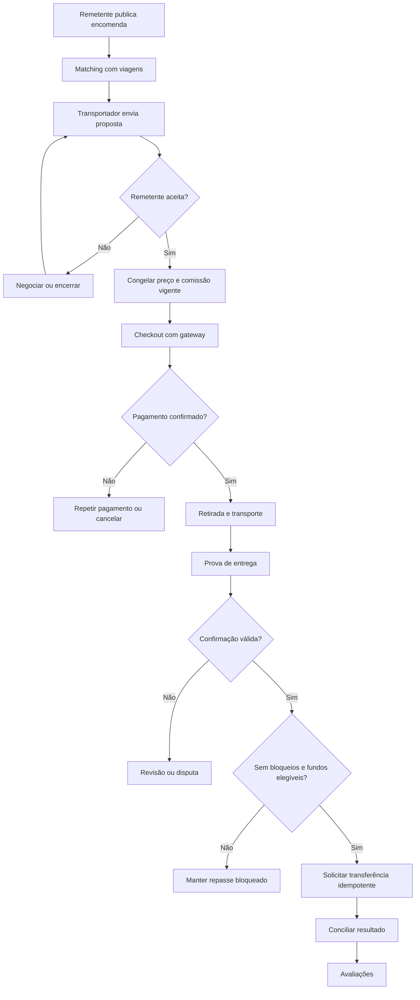
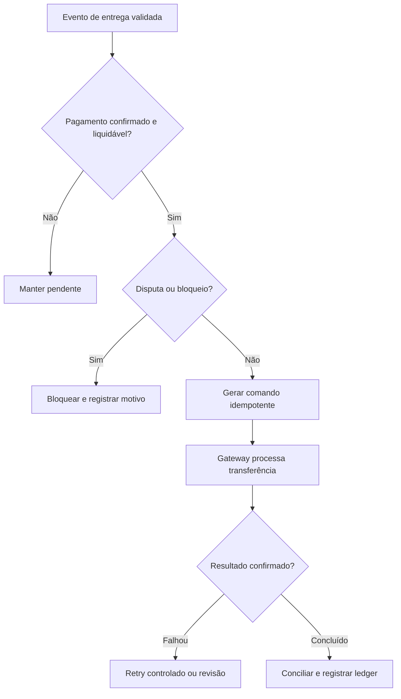

# 03 — Fluxos de Usuário, Negócio e Estados

# Topic Log — Atualização vinculante v2.0 (12/10/2026)

**Precedência:** estas decisões aprovadas substituem qualquer hipótese ou valor incompatível no documento histórico abaixo. A operação real depende de homologação técnica, jurídica e contratual.

| ID | Decisão aprovada |
|---|---|
| D01 | Nome **Topic Log**, domínio pretendido **www.topiclog.com.br**; registro e marca ainda não verificados |
| D02 | Atender **todo o estado de Minas Gerais**, com prioridade de implantação **João Monlevade**, depois **Belo Horizonte** |
| D03 | **Bicicleta, motocicleta e carro** desde o início; encomendas pequenas |
| D04 | Peso máximo padrão: **5 kg bicicleta**, **20 kg motocicleta** e **20 kg carro**, alterável pelo administrador e sujeito à capacidade real e legislação |
| D05 | Cadastro e navegação sem KYC concluído; **verificação obrigatória de cliente/remetente e transportador antes da contratação**, incluindo CPF, identidade, endereço e verificação facial por parceiro apropriado; LGPD e minimização de dados |
| D06 | **Seguro não comercializado** no MVP: usuário somente declara interesse, sem cobrança, apólice ou promessa de cobertura; futura integração configurável |
| D07 | **Asaas** como gateway prioritário, sujeito à homologação de cobrança e repasse posterior à entrega; sandbox até validação |
| D08 | Contratos distribuem responsabilidades entre remetente, transportador e Topic Log dentro da lei; nenhuma cláusula assegura isenção absoluta da plataforma |
| D09 | Regime empresarial pretendido **Lucro Presumido**, com adequação fiscal à Reforma Tributária brasileira, sujeito a validação contábil e jurídica |
| D10 | Comissão gratuita inicial **13%**, configurável pelo administrador, versionada, auditada e sem efeito retroativo |
| D11 | Premium inicial **R$ 39,90/mês** e **7%** de comissão; administrador pode configurar e criar novos pacotes com regras e vigências próprias |
| D12 | **Topic Log absorve taxas ordinárias de gateway**, incluindo Pix, débito, crédito, parcelamento e transferências disponíveis; sem sobretaxa ao remetente por modalidade |
| D13 | Métodos de pagamento configuráveis pelo administrador; ao desabilitar, mostrar aviso ao cliente e impedir novas seleções; só disponibilizar meios efetivamente suportados pelo Asaas |
| D14 | Inicialmente ambiente de **testes**; produção poderá ser AWS ou KingHost conforme custo variável e escala |
| D15 | Mapas com solução gratuita no protótipo respeitando licença e limites; Google Maps ou alternativa futuramente |
| D16 | Entrega normal exige **código de segurança válido + foto**, com procedimento de exceção auditado e revisão autorizada; não liberar repasse por ato unilateral do transportador |
| D17 | Transferência somente após pagamento confirmado/elegível, entrega validada e ausência de disputa/bloqueio; iniciar transferência não equivale a crédito bancário imediato |

**Segurança:** não armazenar biometria bruta ou documentos sem necessidade; avaliar prestador KYC. Para motofrete, bicicleta e carro, o teto comercial não dispensa limites legais, equipamentos e regras municipais. O seguro opcional permanece apenas manifestação de interesse até contrato com seguradora.

---

## Adendo Fluxos — jornadas revisadas

**Cadastro:** usuário cria conta → navega e pesquisa sem KYC → ao tentar contratar, verifica status de ambas as partes → orienta envio seguro de CPF/documento/endereço/face → permite aceite final apenas com KYC válido.

**Encomenda:** preencher dados → escolher bicicleta/moto/carro → validar peso 5/20/20 kg e capacidade efetiva → publicar → match para cidades de MG, priorizando piloto João Monlevade/BH.

**Seguro:** marcar interesse → gravar solicitação → exibir aviso de ausência de cobertura e cobrança.

**Pagamento:** mostrar somente métodos homologados e habilitados pelo admin → aviso quando modalidade for desativada → mesmo preço do transporte independentemente do método → webhook Asaas confirma.

**Entrega:** transportador registra foto → destinatário/remetente fornece código válido → validar os dois → checar pagamento, disputa e antifraude → emitir transferência idempotente. Se faltar um elemento, abrir exceção com revisão humana autorizada; nunca liberar automaticamente.

**Admin:** editar comissão/planos/limites/métodos → pré-visualizar impacto → registrar justificativa e vigência → aplicar apenas a novas contratações.

---

## Conteúdo-base histórico (subordinado às decisões v2.0)

**Projeto:** Marketplace independente de encomendas e rotas  
**Versão:** 1.0 | **Data:** 12/10/2026 | **Status:** especificação proposta para validação  
**Documentos-base:** Especificação Completa v2.0 e Especificação Financeira v1.2.

> **Precedência:** decisões aprovadas prevalecem sobre números antigos: comissão gratuita inicial **13%**, alterável pelo administrador com vigência e auditoria; taxas ordinárias do gateway **absorvidas pela plataforma**; Premium **R$ 39,90/mês e 7%** são hipóteses comerciais configuráveis. Repasse ao transportador somente após confirmação válida de entrega e verificação financeira. Asaas e Stripe Connect são candidatos, não provedores homologados. Nenhum pagamento real sem homologação.

## 1. Fluxo ponta a ponta

## 2. Fluxo de publicação de encomenda
Iniciar rascunho → descrição, categoria, fotos e dimensões → origem/destino aproximados → janela de coleta/entrega → validação de itens proibidos → pré-visualização → publicar. Endereço completo e contato pessoal nunca entram no feed público.

**Falhas:** fotos inválidas, dimensões incompatíveis, origem desconhecida, conta bloqueada, item proibido. Exibir mensagem clara e permitir salvar rascunho quando seguro.

## 3. Fluxo de viagem
Criar viagem → origem/destino e paradas → data/janela → capacidade disponível → restrições → publicar → receber sugestões. Matching é indicativo, não garantia de viabilidade logística.

## 4. Proposta e aceite
Transportador propõe valor e prazo → remetente aceita, recusa ou contrapropõe → proposta vence/expira → ao aceitar, backend executa operação atômica com garantia de uma única vencedora → snapshot comercial: valor, comissão 13% ou plano aplicável, versão de política, transportador devido, condições e timestamps. Uma tentativa concorrente deve retornar conflito sem criar pedido duplicado.

## 5. Pagamento
Pedido aguardando pagamento → checkout exibe **mesmo preço do transporte** para os métodos oferecidos → gateway sandbox cria cobrança → webhook autenticado confirma status → pedido pode avançar. Plataforma registra taxa real de processamento separadamente, inclusive Pix, débito, crédito e parcelamento. Redirecionamento de sucesso não equivale a confirmação.

## 6. Transporte e entrega
Coleta registrada → em trânsito → transportador registra prova → destinatário/remetente confirma via autenticação ou código de uso único → sistema valida evento e ausência de disputa → marca elegibilidade financeira. Prova unilateral do transportador não libera dinheiro.

## 7. Repasse

Transferência iniciada não significa payout bancário concluído. Estados devem aparecer separadamente.

## 8. Disputa e cancelamento
Usuário abre disputa com motivo/evidências → congelar transferência ainda não executada → triagem de suporte → solicitação de provas → decisão registrada e auditada → reembolso, continuidade ou outra medida contratualmente permitida → conciliação. Chargebacks podem surgir após repasse; tratar reversões e passivos sem apagar lançamentos históricos.

## 9. Administração da comissão
Administrador autenticado com permissão financeira → consulta taxa vigente (13%) → propõe novo percentual, justificativa e data de início → pré-visualização do impacto → confirmação reforçada → grava versão imutável e auditoria → taxa aplica-se somente a novas contratações elegíveis. Contratos antigos continuam com snapshot original. Mudança Premium é independente.

## 10. Premium
Transportador visualiza plano, mensalidade e comissão → aceita termos → cobrança recorrente em provedor homologado → webhook confirma assinatura ativa → novas contratações aplicam comissão Premium vigente. Inadimplência/cancelamento têm regras explícitas e não alteram contratos existentes. Premium não concede prioridade em verificações de segurança.

## 11. Estados de interface
Para cada tela prever: carregando, vazio, erro recuperável, acesso negado, offline/intermitência, ação pendente, concluída e cancelada. Ações financeiras não devem ser repetidas pelo usuário sem chave idempotente.

## 12. Casos de teste por fluxo
- Dois transportadores aceitam/negociam simultaneamente; apenas uma proposta vencedora.
- Cliente muda meio de pagamento; valor do transporte permanece igual.
- Gateway envia mesmo webhook três vezes; um único evento financeiro aplicado.
- Transportador marca entregue sem confirmação externa; repasse não elegível.
- Admin muda 13% para 14% durante negociação; contratação recebe versão vigente no instante de aceite, conforme regra definida.
- Disputa aberta após confirmação de entrega mas antes da transferência; bloqueio efetivo.
- Premium expira; novas contratações usam política correspondente, antigas preservadas.
