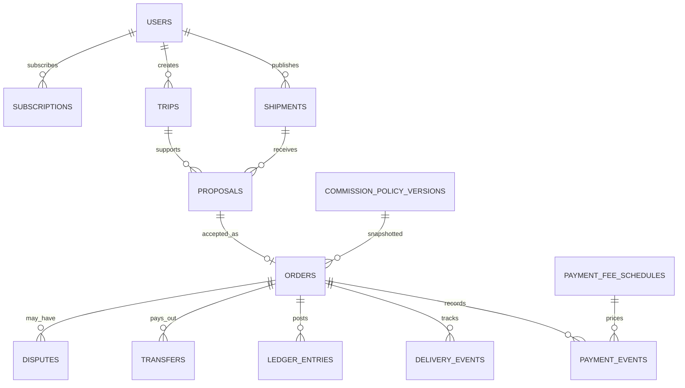

# 05 — Modelo de Dados | PostgreSQL + PostGIS

# Topic Log — Atualização vinculante v2.0 (12/10/2026)

**Precedência:** estas decisões aprovadas substituem qualquer hipótese ou valor incompatível no documento histórico abaixo. A operação real depende de homologação técnica, jurídica e contratual.

| ID | Decisão aprovada |
|---|---|
| D01 | Nome **Topic Log**, domínio pretendido **www.topiclog.com.br**; registro e marca ainda não verificados |
| D02 | Atender **todo o estado de Minas Gerais**, com prioridade de implantação **João Monlevade**, depois **Belo Horizonte** |
| D03 | **Bicicleta, motocicleta e carro** desde o início; encomendas pequenas |
| D04 | Peso máximo padrão: **5 kg bicicleta**, **20 kg motocicleta** e **20 kg carro**, alterável pelo administrador e sujeito à capacidade real e legislação |
| D05 | Cadastro e navegação sem KYC concluído; **verificação obrigatória de cliente/remetente e transportador antes da contratação**, incluindo CPF, identidade, endereço e verificação facial por parceiro apropriado; LGPD e minimização de dados |
| D06 | **Seguro não comercializado** no MVP: usuário somente declara interesse, sem cobrança, apólice ou promessa de cobertura; futura integração configurável |
| D07 | **Asaas** como gateway prioritário, sujeito à homologação de cobrança e repasse posterior à entrega; sandbox até validação |
| D08 | Contratos distribuem responsabilidades entre remetente, transportador e Topic Log dentro da lei; nenhuma cláusula assegura isenção absoluta da plataforma |
| D09 | Regime empresarial pretendido **Lucro Presumido**, com adequação fiscal à Reforma Tributária brasileira, sujeito a validação contábil e jurídica |
| D10 | Comissão gratuita inicial **13%**, configurável pelo administrador, versionada, auditada e sem efeito retroativo |
| D11 | Premium inicial **R$ 39,90/mês** e **7%** de comissão; administrador pode configurar e criar novos pacotes com regras e vigências próprias |
| D12 | **Topic Log absorve taxas ordinárias de gateway**, incluindo Pix, débito, crédito, parcelamento e transferências disponíveis; sem sobretaxa ao remetente por modalidade |
| D13 | Métodos de pagamento configuráveis pelo administrador; ao desabilitar, mostrar aviso ao cliente e impedir novas seleções; só disponibilizar meios efetivamente suportados pelo Asaas |
| D14 | Inicialmente ambiente de **testes**; produção poderá ser AWS ou KingHost conforme custo variável e escala |
| D15 | Mapas com solução gratuita no protótipo respeitando licença e limites; Google Maps ou alternativa futuramente |
| D16 | Entrega normal exige **código de segurança válido + foto**, com procedimento de exceção auditado e revisão autorizada; não liberar repasse por ato unilateral do transportador |
| D17 | Transferência somente após pagamento confirmado/elegível, entrega validada e ausência de disputa/bloqueio; iniciar transferência não equivale a crédito bancário imediato |

**Segurança:** não armazenar biometria bruta ou documentos sem necessidade; avaliar prestador KYC. Para motofrete, bicicleta e carro, o teto comercial não dispensa limites legais, equipamentos e regras municipais. O seguro opcional permanece apenas manifestação de interesse até contrato com seguradora.

---

## Adendo Banco de Dados — extensões de esquema

| Tabela | Campos e regra |
|---|---|
| `service_regions` | UF, código IBGE do município, prioridade, habilitação e status do piloto |
| `vehicle_types` | `BICYCLE`, `MOTORCYCLE`, `CAR`, habilitado |
| `vehicle_limit_versions` | veículo, peso máximo em gramas, vigência, admin e justificativa; seed 5000/20000/20000 |
| `user_vehicle_profiles` | usuário, veículo, capacidade declarada, verificação aplicável |
| `kyc_cases` / `kyc_checks` | usuário, provedor, status, CPF/documento/endereço/face por referência segura, datas de validade |
| `insurance_interests` | encomenda, usuário, interesse e timestamp; sem cobrança/apólice |
| `delivery_challenges` | pedido, hash de código, validade, tentativas, consumido_em |
| `delivery_proofs` | pedido, foto privada, autor, validação |
| `delivery_exceptions` | pedido, motivo, evidências, revisor, decisão e auditoria |
| `payment_method_capabilities` | provedor, modalidade, homologada, habilitada, máximo parcelas e vigência |
| `subscription_plan_versions` | pacote, preço, comissão, benefícios, vigência e ativo |
| `admin_policy_events` | autor, recurso, antes/depois, motivo, data |

**Integridade:** bloqueio de contrato sem KYC válido bilateral; peso <= limite do modal e capacidade; código de entrega de uso único; foto obrigatória na via normal; repasse condicionado a prova dupla ou exceção aprovada; planos e comissões congelados no pedido; índices geográficos PostGIS e por status; evitar armazenamento de biometria bruta.

---

## Conteúdo-base histórico (subordinado às decisões v2.0)


**Projeto:** Marketplace independente de encomendas e rotas  
**Versão:** 1.0 | **Data:** 12/10/2026 | **Status:** especificação proposta para validação  
**Documentos-base:** Especificação Completa v2.0 e Especificação Financeira v1.2.

> **Precedência:** decisões aprovadas prevalecem sobre números antigos: comissão gratuita inicial **13%**, alterável pelo administrador com vigência e auditoria; taxas ordinárias do gateway **absorvidas pela plataforma**; Premium **R$ 39,90/mês e 7%** são hipóteses comerciais configuráveis. Repasse ao transportador somente após confirmação válida de entrega e verificação financeira. Asaas e Stripe Connect são candidatos, não provedores homologados. Nenhum pagamento real sem homologação.


## 1. Princípios
PostgreSQL com PostGIS, UUID como chave primária, `created_at`/`updated_at` UTC, `deleted_at` apenas onde aplicável, chaves estrangeiras, checks e índices. Dados financeiros em **centavos inteiros** e moeda ISO; percentuais como `numeric(9,6)` ou representação explícita em basis points, com política de arredondamento. Migrações versionadas. Não salvar dados completos de cartão.

## 2. Diagrama conceitual


## 3. Catálogo inicial de tabelas
| Tabela | Campos essenciais | Restrições |
|---|---|---|
| `users` | id, email_normalized, password_hash/external_subject, status | email único |
| `profiles` | user_id, display_name, phone_encrypted, role_flags | FK e visibilidade |
| `verification_cases` | user_id, provider, status, reviewed_at | sem documentos públicos |
| `shipments` | id, sender_id, description, category, weight_g, status, pickup_window, delivery_window | checks e ownership |
| `shipment_addresses` | shipment_id, kind, address_encrypted, approximate_point | endereços exatos restritos |
| `trips` | id, carrier_id, origin_point, destination_point, start_window, end_window, capacity_g, status | GIST geométrico |
| `trip_waypoints` | trip_id, seq, point, window | seq único por viagem |
| `matches` | shipment_id, trip_id, score, reason, computed_at | sem promessa de rota real |
| `proposals` | id, shipment_id, trip_id, carrier_id, amount_cents, currency, status, expires_at, version | índices por status |
| `proposal_events` | proposal_id, actor_id, event_type, payload, created_at | append-only |
| `orders` | id, shipment_id, accepted_proposal_id, sender_id, carrier_id, amount_cents, commission_rate, commission_cents, carrier_due_cents, commission_policy_version_id, status | snapshot imutável |
| `conversations` | id, shipment_id, order_id, status | ACL |
| `messages` | id, conversation_id, sender_id, body, sent_at, status | index cronológico |
| `delivery_events` | id, order_id, actor_id, type, occurred_at, evidence_id | append-only |
| `delivery_proofs` | id, order_id, storage_key, verification_method, verifier_id, verified_at | URL privada |
| `disputes` | id, order_id, opened_by, reason, status, resolution | bloquear repasse |
| `reviews` | id, order_id, reviewer_id, reviewed_id, rating, comment | único por par/operação |
| `commission_policy_versions` | id, plan_code, rate, effective_from, effective_to, actor_id, reason | intervalos não conflitantes |
| `payment_fee_schedules` | id, provider, method, installments, percent_rate, fixed_cents, valid_from, valid_to | tarifas por modalidade |
| `subscription_plans` | id, code, price_cents, commission_policy_version_id, active | versão comercial |
| `subscriptions` | id, user_id, plan_id, provider_subscription_id, status, period_end | id externo único |
| `payment_intents` | id, order_id, provider, provider_payment_id, amount_cents, status | idempotência |
| `payment_events` | id, payment_id, provider_event_id, type, fee_cents, occurred_at | evento único |
| `provider_accounts` | id, user_id, provider, provider_account_id, status | referência externa |
| `transfers` | id, order_id, provider_transfer_id, amount_cents, status, idempotency_key | um comando ativo elegível |
| `payouts` | id, transfer_id, provider_payout_id, status, settled_at | distinguir do transfer |
| `ledger_accounts` | id, code, type, currency | plano contábil interno |
| `ledger_entries` | id, transaction_id, account_id, direction, amount_cents, order_id, created_at | partida dobrada |
| `webhook_inbox` | provider, external_event_id, payload_ref, verified, processed_at | unique(provider,event) |
| `outbox_events` | id, aggregate_type, aggregate_id, event_type, payload, processed_at | entrega ao worker |
| `audit_events` | id, actor_id, action, resource_type, resource_id, before_hash, after_hash, occurred_at | append-only |
| `notifications` | id, user_id, channel, template, status | preferências |

## 4. Índices e constraints críticas
- `users(email_normalized)` UNIQUE.
- `trips` e `shipment_addresses(approximate_point)` GIST; nunca indexar publicamente endereço exato.
- `proposals(shipment_id, status)` e `orders(shipment_id)` com UNIQUE para pedido contratado ativo conforme regra de cancelamento.
- `payment_events(provider_event_id, provider)` UNIQUE.
- `transfers(idempotency_key)` UNIQUE; referência externa única por provedor.
- `commission_policy_versions(plan_code, effective_from)` UNIQUE e constraint de não sobreposição temporal (usar exclusion constraint se adequada).
- `orders`: `amount_cents >= 0`, `commission_cents >= 0`, `carrier_due_cents >= 0`, `commission_cents + carrier_due_cents = amount_cents`.
- `ledger_entries`: validação transacional de débito/crédito balanceados por `transaction_id`; não apagar lançamentos, criar reversões.

## 5. Exemplo SQL ilustrativo
```sql
CREATE TABLE commission_policy_versions (
  id uuid PRIMARY KEY,
  plan_code text NOT NULL,
  rate numeric(9,6) NOT NULL CHECK (rate >= 0 AND rate <= 1),
  effective_from timestamptz NOT NULL,
  effective_to timestamptz,
  actor_id uuid NOT NULL,
  reason text NOT NULL,
  created_at timestamptz NOT NULL DEFAULT now(),
  CHECK (effective_to IS NULL OR effective_to > effective_from)
);
-- Seed: plan_code='FREE', rate=0.130000; PREMIUM=0.070000 (proposta).
-- Adicionar constraints de não sobreposição por plano na migration definitiva.
```

## 6. Privacidade e retenção
Separar pontos aproximados públicos de endereços privados criptografados; criptografar documentos/telefones sensíveis quando aplicável; acesso restrito e auditado. Definir retenção e descarte após revisão jurídica. Não armazenar PAN/CVV de cartões.

## 7. Conciliação financeira
Para cada pedido, registrar: valor pago, comissão congelada, valor do transportador, taxas reais do gateway por método, estornos, chargebacks, transferências, payouts e diferença de conciliação. O ledger deve permitir reversões sem exclusão. Relatórios agregam por provedor, método, parcelas, plano e período.

## 8. Migrações e testes
Criar migrations EF Core, seeds mínimos, testes de integridade, concorrência de aceite, reprocessamento de webhook, precisão de centavos, transição de comissão 13→14%, Premium, estorno e restauração de backup. Este catálogo é lógico: tipos e nomes finais devem ser justificados no ADR.
