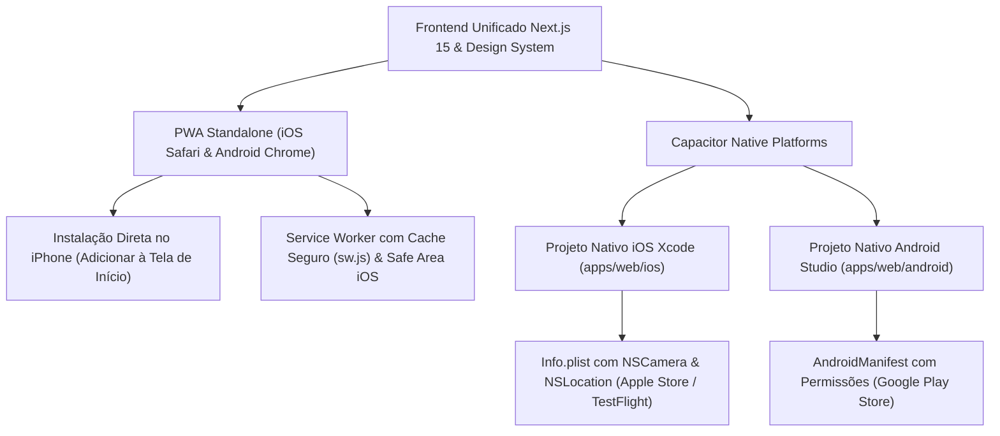

# 08 — App Mobile | PWA, iOS & Capacitor Android

**Projeto:** Topic Log — Marketplace de Encomendas e Rotas  
**Status:** Implementado  
**Identificador Android & iOS:** `br.com.topiclog.app`  

---

## 1. Arquitetura da Solução Mobile Multiplataforma

O aplicativo para celular da Topic Log atende de forma unificada tanto a smartphones **Android** quanto **iPhone (iOS)**:



---

## 2. Como Usar e Testar no iPhone (iOS)

### Opção A — Instalação Imediata no iPhone (PWA Standalone)
Esta é a forma mais rápida e recomendada para testes em campo, dispensando conta de desenvolvedor Apple ou computador Mac:

1. **Inicie o servidor de desenvolvimento:**
   ```powershell
   cd c:\Projetos\TOPICLOG\apps\web
   npm run dev
   ```
2. **No seu iPhone:**
   - Conecte o iPhone à mesma rede Wi-Fi do seu computador.
   - Abra o **Safari** (ou Chrome) e digite o endereço IP do seu computador na rede (exemplo: `http://192.168.0.11:3000`).
   - O aplicativo carregará adaptado à tela do iPhone, com suporte à área do notch/Dynamic Island e barra de navegação inferior.
   - O componente na tela mostrará o botão para instalação.
3. **Fixar na Tela de Início do iPhone:**
   - Toque no botão de **Compartilhar** do Safari (ícone de quadrado com a seta para cima ⎋ na barra inferior).
   - Role o menu de opções para baixo e selecione **"Adicionar à Tela de Início"** (ícone ➕).
   - Toque em **"Adicionar"** no canto superior direito.
4. **Pronto!** O ícone oficial do **Topic Log** aparecerá na sua grade de aplicativos do iOS. Ao abrir, o app roda em **tela cheia nativa** (sem barra de URL do Safari), com a barra inferior segura contra a barra de início do iOS (`env(safe-area-inset-bottom)`).

---

### Opção B — Projeto Nativo iOS para Xcode / Apple App Store

O invólucro nativo para iOS foi gerado com Capacitor em [`apps/web/ios`](file:///C:/Projetos/TOPICLOG/apps/web/ios):

- **Bundle Identifier:** `br.com.topiclog.app`
- **Ícone do Aplicativo:** `AppIcon-512@2x.png` (1024 × 1024 px) configurado no catálogo de ativos do Xcode.
- **Permissões no [`Info.plist`](file:///C:/Projetos/TOPICLOG/apps/web/ios/App/App/Info.plist):**
  - `NSCameraUsageDescription`: Acesso à câmera traseira para a foto obrigatória de entrega (D16).
  - `NSLocationWhenInUseUsageDescription`: Coordenadas de GPS para localização de encomendas e rotas em Minas Gerais.
  - `NSPhotoLibraryUsageDescription`: Seleção de comprovantes ou fotos de pacotes da galeria.
  - `NSPhotoLibraryAddUsageDescription`: Permissão para salvar comprovantes fotográficos gerados.

*Nota de compilação:* Para gerar o binário `.ipa` nativo assinado para a App Store ou TestFlight, basta abrir a pasta `apps/web/ios/App` no Xcode em ambiente macOS ou via pipeline CI/CD (GitHub Actions com `macos-latest`).

---

## 3. Comandos Operacionais

Executados a partir de `apps/web`:

- `npm run cap:sync`: Sincroniza simultaneamente as alterações para **iOS** e **Android**.
- `npm run cap:sync:ios`: Sincroniza exclusivamente a pasta do iOS.
- `npm run cap:sync:android`: Sincroniza exclusivamente a pasta do Android.
- `npm run cap:open:android`: Abre o Android Studio.
- `npm run cap:open:ios`: Abre o Xcode (em ambiente macOS).
- `npm run icons:generate`: Regenera automaticamente todos os ícones PNG (PWA, mipmaps Android e AppIcon 1024px iOS) a partir dos vetores SVG.
